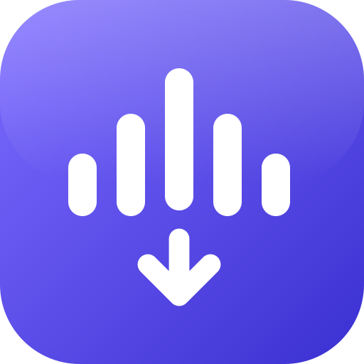
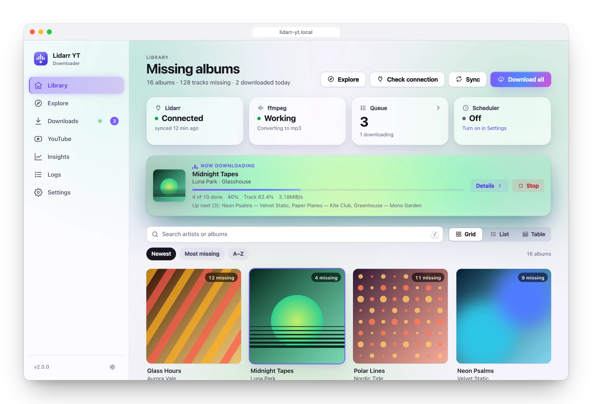
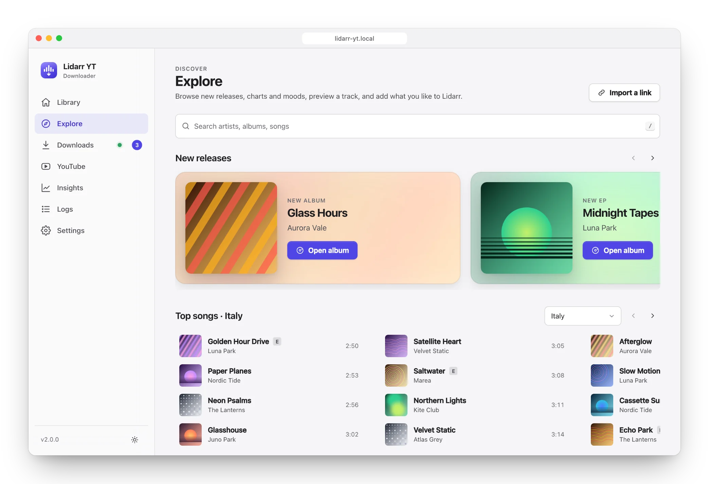
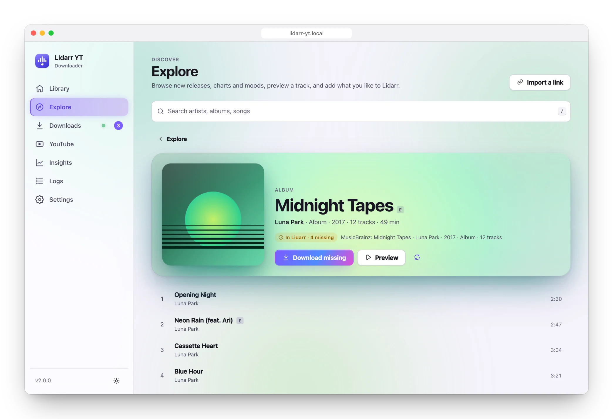
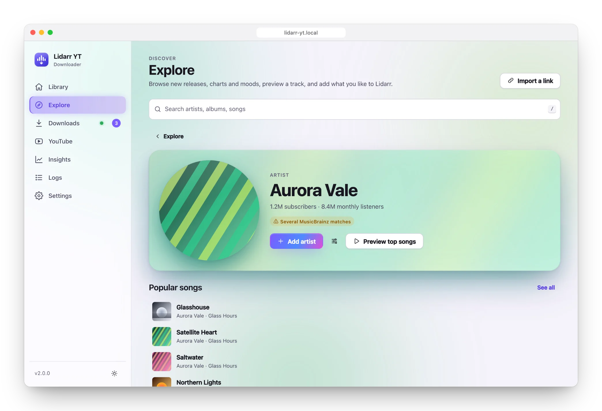
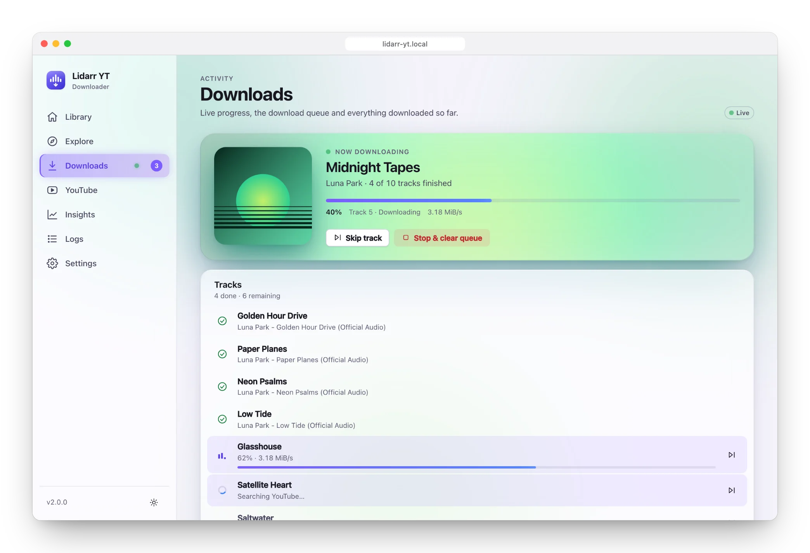
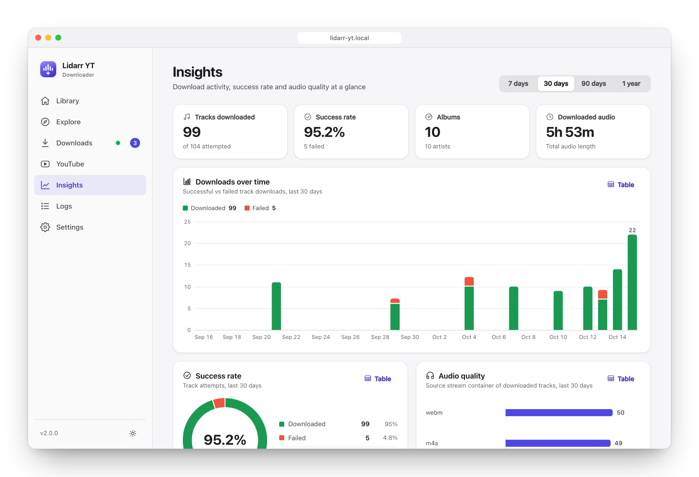
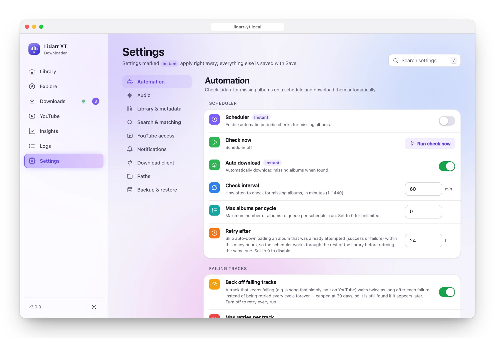
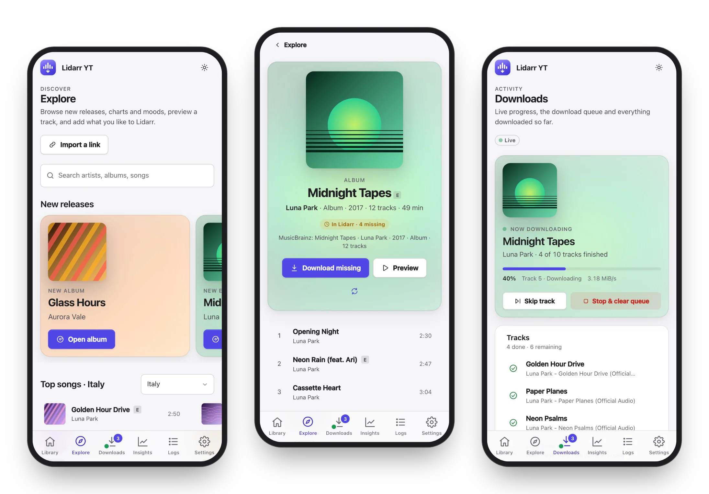

<div align="center">

<br>



<h1>Lidarr YouTube Downloader</h1>

<p><b>The missing albums in your Lidarr library, found on YouTube.</b><br>
<sub>Matched, verified, tagged and imported — from one self-hosted web app that takes its colours from your music.</sub></p>

<p>
<a href="CHANGELOG.md"></a>
<a href="#-quick-start"></a>
<a href="requirements.txt"></a>
<a href="LICENSE"></a>
</p>

<p>
<a href="#-quick-start"><b>Quick start</b></a> &nbsp;·&nbsp;
<a href="#-features"><b>Features</b></a> &nbsp;·&nbsp;
<a href="#-a-tour"><b>Tour</b></a> &nbsp;·&nbsp;
<a href="#-configuration"><b>Configuration</b></a> &nbsp;·&nbsp;
<a href="#-faq"><b>FAQ</b></a>
</p>

<br>

<picture>
  <source media="(prefers-color-scheme: dark)" srcset="docs/screenshots/library-dark.webp">
  
</picture>

</div>

<br>

<div align="center">
<table>
<tr>
<td align="center" width="25%"><h3>15</h3><sub>YouTube candidates<br>scored per track</sub></td>
<td align="center" width="25%"><h3>AcoustID</h3><sub>fingerprint check<br>before import</sub></td>
<td align="center" width="25%"><h3>MP3 · M4A · Opus</h3><sub>with MusicBrainz ids<br>and cover art</sub></td>
<td align="center" width="25%"><h3>1 container</h3><sub>NAS, Unraid, Pi<br>or a VPS</sub></td>
</tr>
</table>
</div align="center">

<br>

## ✦ Features

<table>
<tr>
<td width="33%" valign="top">

#### Smart matching
<sub>The official YouTube Music album first, then up to 15 candidates per track — scored by title, duration, official channel and forbidden words.</sub>

</td>
<td width="33%" valign="top">

#### Verified audio
<sub>Optional AcoustID fingerprinting rejects the wrong song before it ever reaches your library.</sub>

</td>
<td width="33%" valign="top">

#### Complete tags
<sub>MusicBrainz ids the way Picard writes them, embedded covers, optional synced lyrics and ReplayGain.</sub>

</td>
</tr>
<tr>
<td valign="top">

#### Native to Lidarr
<sub>Files land in your library and Lidarr refreshes — or register the app as a Newznab indexer and SABnzbd client.</sub>

</td>
<td valign="top">

#### Explore
<sub>Browse new releases, charts and moods, get artists picked from your own library, preview any track and add it to Lidarr in two clicks.</sub>

</td>
<td valign="top">

#### Hands-off
<sub>A scheduler fetches new releases on its own, backs off tracks that keep failing and notifies Telegram, Discord, ntfy or any of the 100+ services Apprise supports.</sub>

</td>
</tr>
</table>

<br>

## ✦ A tour

### Explore a whole catalog

New releases, top songs per country, trending tracks, charts and moods — with a mini player that previews anything before you download it.

<picture>
  <source media="(prefers-color-scheme: dark)" srcset="docs/screenshots/explore-dark.webp">
  
</picture>

<br>

### One button for every album

Open an album and it is already matched to MusicBrainz through Lidarr. **Add & download** puts it in Lidarr and downloads it straight from the YouTube Music album you were looking at — whether it is complete, missing tracks, unmonitored or not in Lidarr yet.

<picture>
  <source media="(prefers-color-scheme: dark)" srcset="docs/screenshots/album-dark.webp">
  
</picture>

<br>

### Artists, even the ones MusicBrainz doesn't know

Add an artist to Lidarr with one click. If it isn't on MusicBrainz, **Add from YouTube** builds a Lidarr-style `Artist/Album (Year)` folder for every release, with covers and an `artist.jpg`.

<picture>
  <source media="(prefers-color-scheme: dark)" srcset="docs/screenshots/artist-dark.webp">
  
</picture>

<br>

### Watch it happen

Per-track progress, speed and verification, a queue you can reorder or pause, and a history you can filter by outcome and audio quality.

<picture>
  <source media="(prefers-color-scheme: dark)" srcset="docs/screenshots/downloads-dark.webp">
  
</picture>

<br>

### Insights and settings

<table>
<tr>
<td width="50%" valign="top">
<picture>
  <source media="(prefers-color-scheme: dark)" srcset="docs/screenshots/insights-dark.webp">
  
</picture>
<p align="center"><sub><b>Insights</b> — success rate, audio quality and activity over time.</sub></p>
</td>
<td width="50%" valign="top">
<picture>
  <source media="(prefers-color-scheme: dark)" srcset="docs/screenshots/settings-dark.webp">
  
</picture>
<p align="center"><sub><b>Settings</b> — every option in one sectioned, searchable page.</sub></p>
</td>
</tr>
</table>

<br>

### In your pocket

Dark and light themes, glass surfaces and a background that glows in the colours of the album you're looking at — with touch-sized controls and a tab bar. Add it to your home screen and it opens like an app.

<p align="center">
<picture>
  <source media="(prefers-color-scheme: dark)" srcset="docs/screenshots/mobile-dark.webp">
  
</picture>
</p>

<br>

## ✦ Quick start

**1 · Describe the container** in a `docker-compose.yml`:

```yaml
services:
  lidarr-downloader:
    image: angrido/lidarr-downloader:latest
    container_name: lidarr-downloader
    ports:
      - "5005:5000"
    volumes:
      - ./config:/config
      - /DATA/Downloads:/DATA/Downloads
      - /DATA/Media/Music:/music
    environment:
      - LIDARR_URL=http://192.168.1.XXX:8686
      - LIDARR_API_KEY=your_api_key_here
      - DOWNLOAD_PATH=/DATA/Downloads
      - LIDARR_PATH=/music
      - PUID=1000
      - PGID=1000
      - UMASK=002
    restart: unless-stopped
```

**2 · Start it:**

```bash
docker compose up -d
```

**3 · Open `http://localhost:5005`** — a short setup wizard checks the Lidarr connection; everything else lives in **Settings**.

> [!TIP]
> The repository's [`docker-compose.yml`](docker-compose.yml) also starts a [bgutil PO-token provider](https://github.com/Brainicism/bgutil-ytdlp-pot-provider) sidecar, which avoids most *"Sign in to confirm you're not a bot"* errors.

<br>

## ✦ How it works

| | Step | What happens |
|:-:|---|---|
| 1 | **Sync** | Lidarr's missing albums are paged into a local SQLite cache, so the UI is instant. |
| 2 | **Search** | The official YouTube Music album is tried first, then up to 15 candidates per track. |
| 3 | **Score** | Title, duration window, official channel and forbidden words (remix, live, karaoke…). |
| 4 | **Verify** | Optional AcoustID fingerprint against the expected MusicBrainz recording. |
| 5 | **Tag** | Tags, MusicBrainz ids and cover art; optional `.lrc` lyrics, ReplayGain and XML sidecar. |
| 6 | **Import** | Files are copied into your library and Lidarr refreshes the artist. |

<br>

## ✦ Configuration

| Variable | Example | Description |
|---|---|---|
| `LIDARR_URL` | `http://192.168.1.10:8686` | Lidarr base URL (use the LAN IP) |
| `LIDARR_API_KEY` | `abc123…` | Lidarr → Settings → General |
| `DOWNLOAD_PATH` | `/DATA/Downloads` | Where new tracks are saved |
| `LIDARR_PATH` | `/music` | Your music library, as mounted in the container |
| `PUID` / `PGID` / `UMASK` | `1000` / `1000` / `002` | File ownership, matching Lidarr |
| `ALLOWED_HOSTS` | `192.168.1.10,music.example.com` | Optional. When set, requests whose `Host` header is not listed get a 400, which blocks DNS-rebinding attacks. List every address you (or Lidarr's download-client bridge) use to reach the app; `localhost` is always allowed and `*.example.com` matches sub-domains. Empty (default) accepts any host. |
| `AUTH_USERNAME` / `AUTH_PASSWORD` | `admin` / `…` | Optional: require this login (otherwise turn it on in Settings › Security) |

Audio format and quality, parallel tracks, match threshold, forbidden words, scheduler, notifications (Telegram, Discord, ntfy, Apprise), the Lidarr tag for downloaded artists, the optional login, AcoustID and yt-dlp tuning are all set in **Settings**. Explore's default region and language come from `EXPLORE_COUNTRY` (default `IT`) and `EXPLORE_LANGUAGE` (default `en`); the chart country can also be switched right on the Explore page.

<details>
<summary><b>YouTube cookies</b> — when YouTube asks you to sign in</summary>

<br>

1. Install the **Get cookies.txt LOCALLY** browser extension.
2. In a private window, sign in to a **throwaway** Google account.
3. Export the cookies in **Netscape** format as `cookies.txt`.
4. Mount it and point the app at it:

```yaml
volumes:
  - ./cookies.txt:/cookies/cookies.txt
environment:
  - YT_COOKIES_FILE=/cookies/cookies.txt
```

Never use your main Google account: cookies expire and accounts can be flagged. The app never modifies your file — every download works on a private copy.

</details>

<details>
<summary><b>VPN with gluetun</b> — change the IP YouTube sees</summary>

<br>

When YouTube starts answering *"Sign in to confirm you're not a bot"* or *"Too many requests"*, the address is the problem. Run [gluetun](https://github.com/qdm12/gluetun) next to the app and it can send every request it makes to YouTube through your VPN, and **change the IP** by restarting the tunnel — on a button, every N albums, or automatically after YouTube blocked a request.

1. Start gluetun with its HTTP proxy and an API key for the control server, using the bundled [`docker-compose.gluetun.yml`](docker-compose.gluetun.yml) (see the comments inside for the `.env` values):

   ```bash
   docker compose -f docker-compose.yml -f docker-compose.gluetun.yml up -d --build
   ```

2. The compose file sets `VPN_PROXY_URL`, `GLUETUN_CONTROL_URL` and `GLUETUN_API_KEY` for the app. They can also be filled in under **Settings → YouTube access → VPN (gluetun)**, where **Test** checks both and **Change IP now** restarts the VPN.

| Variable | Example | Description |
|---|---|---|
| `VPN_PROXY_URL` | `http://gluetun:8888` | Gluetun's HTTP proxy (`HTTPPROXY=on`). Everything asked of YouTube goes through it |
| `GLUETUN_CONTROL_URL` | `http://gluetun:8000` | Gluetun's control server; needed to change the IP |
| `GLUETUN_API_KEY` | `…` | Sent as `X-API-Key`; recent gluetun versions refuse unauthenticated control requests |

Good to know:

- **The PO token provider uses the same proxy.** yt-dlp's bgutil plugin hands the proxy to the sidecar, which uses it for its own requests, so the token is generated from the same address as the download. The proxy URL must therefore be reachable from the sidecar's container too: `http://gluetun:8888` works when both are on the same compose network.
- **Only YouTube traffic uses the VPN**: searches, downloads, the YT Music album lookups a download makes, cover scraping and preview streams. Lidarr, notifications, the web UI and Explore browsing keep the normal network, so nothing else changes.
- **The IP only changes when nothing is downloading.** When an automatic change is due, the queue starts nothing new until the running albums have finished, then restarts the tunnel and carries on. **Change IP now** is refused while a download is running and otherwise works in the background. A restart usually takes a few seconds, occasionally a few minutes if the VPN has to retry. Automatic changes are at most once every 5 minutes.
- **YouTube often refuses VPN addresses** (*"Sign in to confirm you're not a bot"*), datacenter ranges especially. That is what the automatic change is for: the next album starts on another address. Cookies or the PO token provider above still help on top of it.
- **List several locations** in gluetun's server filter (`SERVER_REGIONS`, `SERVER_COUNTRIES`… depending on the provider). With a single server a restart can bring back the same address; the app tells you when that happens.
- Never publish gluetun's port 8000 on your LAN: the control server can stop your VPN.

</details>

<details>
<summary><b>Spotify, Deezer, Apple Music and ListenBrainz playlists</b></summary>

<br>

Paste a playlist or album link from YouTube, Spotify, Deezer, Apple Music or ListenBrainz on the **Import** page. Every track is searched on YouTube with the same scoring used for Lidarr albums, tagged with its own artist and saved with an `.m3u8` playlist file next to it, so the playlist shows up in Jellyfin, Navidrome or Plex. **Add albums to Lidarr** instead looks up the albums of the selected tracks on MusicBrainz, adds them to Lidarr and queues them, so they arrive whole with full tags.

No key is needed. Without one Spotify only shows the first 100 tracks of a playlist; add a Spotify app's client ID and secret in Settings › Library & metadata to read all of them. Apple Music playlists are read from the public page and may break if Apple changes it; Apple Music albums use the iTunes API.

</details>

<details>
<summary><b>AcoustID fingerprinting</b> — verify every track</summary>

<br>

Enable it in Settings and paste an [AcoustID API key](https://acoustid.org/new-application). The image already ships `fpcalc` (chromaprint).

</details>

<details>
<summary><b>Use as a Lidarr download client</b> — let Lidarr drive the whole flow</summary>

<br>

The app can register **inside Lidarr** as a Newznab indexer and a SABnzbd download client. Lidarr then searches, grabs, monitors and imports exactly as it would with Usenet.

| Surface | Emulates | Endpoint |
|---|---|---|
| Indexer | Newznab | `/api/newznab/api` |
| Download client | SABnzbd | `/api/sabnzbd` |

1. **This app → Settings → Lidarr Download Client**: enable it, **Generate** an API key, set a **Category** (default `music`) and save.
2. **Lidarr → Settings → Indexers → + → Newznab** (custom): URL `http://<this-app-host>:<port>`, API Path `/api/newznab/api`, the API key. Test, then save.
3. **Lidarr → Settings → Download Clients → + → SABnzbd**: this app's host and port, URL Base `/api/sabnzbd`, the same key and category. Test, then save.
4. **Lidarr → Settings → Media Management**: enable **Completed Download Handling**.

In this mode files stay in the download folder for Lidarr to import, so that folder must be visible to Lidarr at the same path (or through a remote path mapping). Albums attempted recently are held back for `scheduler_retry_after_hours` (default 24 h) so a failing album is not grabbed again and again. With **RSS sync** on, Lidarr grabs missing albums from the feed automatically; turn RSS off on the indexer if you only want explicit searches.

</details>

<details>
<summary><b>Upgrading from the JSON state of old versions</b></summary>

<br>

```bash
docker exec -it lidarr-downloader python3 tools/migrate_json_to_db.py --config-dir /config
```

The originals are renamed to `*.json.migrated`.

</details>

<br>

## ✦ FAQ

<details>
<summary><b>Does it replace a real indexer?</b></summary>
<br>
No — it is a fallback for albums your indexers can't find. Audio quality is limited to what YouTube serves.
</details>

<details>
<summary><b>Does it work with Plex, Jellyfin or Navidrome?</b></summary>
<br>
Yes. Files are imported into Lidarr's library, where any music server picks them up.
</details>

<details>
<summary><b>Which audio formats are supported?</b></summary>
<br>
MP3 (up to 320 kbps), M4A and Opus, selectable in Settings. M4A keeps YouTube's native stream without re-encoding.
</details>

<details>
<summary><b>Can I download a playlist or a single video?</b></summary>
<br>
Yes. Paste any YouTube or YouTube Music link on the <b>Import</b> page, or open a playlist in Explore and pick the tracks.
</details>

<details>
<summary><b>What about artists that aren't on MusicBrainz?</b></summary>
<br>
Lidarr can't track them, so Explore offers <b>Add from YouTube</b>: one click creates the artist folder with one folder per release, tagged and with covers. Running it again later only fetches new releases.
</details>

<details>
<summary><b>Is yt-dlp kept up to date?</b></summary>
<br>
It is checked at startup, and Settings upgrades it with one click.
</details>

<br>

## ✦ Development

```bash
git clone https://github.com/Angrido/Lidarr-YouTube-Downloader.git
cd Lidarr-YouTube-Downloader
python -m venv .venv && source .venv/bin/activate
pip install -r requirements.txt
python app.py                            # http://localhost:5000
python -m pytest tests/                  # test suite
python tools/explore_preview.py --demo   # UI with demo data, no Lidarr or downloads
```

The screenshots come from that demo — artists, albums and covers are generated, not real. With the demo running, `npx -y -p playwright node tools/readme_screenshots.js` captures them again in both themes.

<br>

## ✦ Disclaimer

For **personal use** with your own music library. You are responsible for complying with copyright law and YouTube's Terms of Service. Explore reads public YouTube Music pages through the unofficial [ytmusicapi](https://github.com/sigma67/ytmusicapi) library and is not affiliated with or endorsed by YouTube or Google; what it shows depends on what YouTube serves to your server and can change without notice.

<br>

<div align="center">

<a href="https://www.star-history.com/?repos=Angrido%2FLidarr-YouTube-Downloader&type=date&legend=top-left">
 <picture>
   <source media="(prefers-color-scheme: dark)" srcset="https://api.star-history.com/image?repos=Angrido/Lidarr-YouTube-Downloader&type=date&theme=dark&legend=top-left" />
   <source media="(prefers-color-scheme: light)" srcset="https://api.star-history.com/image?repos=Angrido/Lidarr-YouTube-Downloader&type=date&legend=top-left" />
   
 </picture>
</a>

<br><br>


<sub>Made with care for the self-hosted music community · MIT licensed</sub>

</div>
